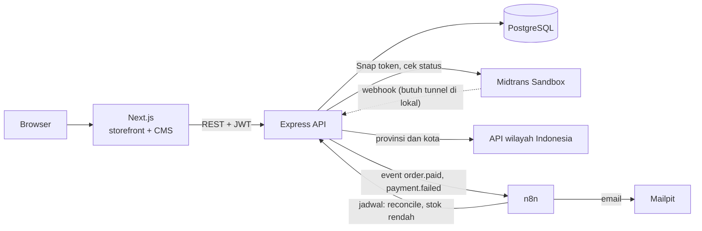

# Wander

Website toko sepatu online dengan CMS admin. Frontend dan CMS memakai Next.js, API memakai Express dan PostgreSQL, pembayaran lewat Midtrans Snap (sandbox), dan otomasi email lewat n8n.

## Fitur

Storefront:

- Beranda dengan banner promo, koleksi khusus pria dan wanita, serta produk terbaru.
- Pencarian dari header, filter kategori, dan hasil yang dibagi per halaman.
- Detail produk dengan info ketersediaan stok, produk serupa, dan pilihan lainnya.
- Keranjang yang tersimpan di browser, dengan pengatur jumlah.
- Checkout dengan pilihan provinsi dan kota, serta ongkos kirim yang dihitung otomatis.
- Pembayaran lewat Midtrans Snap, dan status pesanan langsung berubah setelah dibayar.
- Riwayat dan detail pesanan.
- Login dan register.
- Tampilan responsif.

CMS (`/admin`):

- Dashboard berisi pendapatan, jumlah order per status, produk aktif, stok, dan produk terlaris.
- Kelola produk: tambah, ubah, aktifkan atau nonaktifkan, dan hapus.
- Kelola kategori: tambah, ubah, dan hapus.
- Kelola order: filter berdasarkan status dan ubah status. Membatalkan order yang belum dibayar akan mengembalikan stok.

API dan integrasi:

- REST API dengan JWT dan role `ADMIN` / `CUSTOMER`, validasi zod, dan dokumentasi Swagger.
- Midtrans Snap untuk token pembayaran, webhook dengan verifikasi signature, dan pengecekan status langsung ke Midtrans.
- Daftar provinsi dan kota dari [API wilayah Indonesia](https://emsifa.github.io/api-wilayah-indonesia/), di-cache 24 jam.
- Lima workflow n8n untuk notifikasi, jadwal, rekonsiliasi pembayaran, dan penanganan error.

## Arsitektur



Status pembayaran diperbarui lewat tiga jalur yang memakai satu fungsi yang sama di API:

1. Webhook dari Midtrans. Ini jalur utama di produksi.
2. Pengecekan langsung ke Midtrans begitu pelanggan selesai di popup Snap, lalu diulang tiap 5 detik di halaman pesanan yang masih PENDING.
3. Rekonsiliasi dari n8n tiap jam sebagai cadangan.

## Tech stack

| Bagian        | Stack                                                    |
| ------------- | -------------------------------------------------------- |
| Frontend      | Next.js 16 (App Router, React 19), Tailwind 4, shadcn/ui |
| Backend       | Express 5 dan TypeScript                                 |
| Validasi      | zod                                                      |
| Database      | PostgreSQL 16 dan Prisma 7                               |
| Auth          | JWT (HS256) dan bcrypt                                   |
| Pembayaran    | Midtrans Snap sandbox                                    |
| Otomasi       | n8n                                                      |
| Email dev     | Mailpit                                                  |
| Infrastruktur | Docker Compose                                           |

## Struktur folder

```
.
├── apps/
│   ├── api/
│   │   ├── prisma/          schema, migrasi, seed
│   │   ├── src/
│   │   │   ├── common/         auth, api key, error HTTP, validasi
│   │   │   ├── integrations/   midtrans, wilayah, n8n
│   │   │   ├── modules/        auth, products, categories, orders, payments, regions, dashboard, internal
│   │   │   ├── app.ts          Express, CORS, router, Swagger
│   │   │   ├── container.ts    pembuatan service
│   │   │   └── openapi.ts      dokumen Swagger
│   │   └── test/            tes HTTP
│   └── web/
│       └── src/
│           ├── app/         halaman storefront dan admin
│           ├── components/  header, banner, kartu produk, modal login, skeleton, ui
│           └── lib/         klien API, auth, keranjang, pembayaran, foto
├── n8n/workflows/           workflow n8n (JSON)
├── docker-compose.yml
└── .env.example
```

## Cara Menjalankan

Yang dibutuhkan:

- Node.js minimal versi 20.9
- Docker dengan Docker Compose
- akun [Midtrans Sandbox](https://dashboard.sandbox.midtrans.com/) untuk Server Key dan Client Key.

### 1. Siapkan `.env`

```bash
cp .env.example .env
```

Isi nilai yang masih kosong:

```bash
openssl rand -base64 48     # JWT_SECRET
openssl rand -hex 32        # N8N_API_KEY
```

Isi juga `MIDTRANS_SERVER_KEY` dan `MIDTRANS_CLIENT_KEY` dari Midtrans Dashboard (Settings, Access Keys, environment Sandbox). Semua aplikasi memakai satu `.env` di root.

### 2. Jalankan Postgres, n8n, dan Mailpit

```bash
docker compose up -d
```

- PostgreSQL di `localhost:5432`
- n8n di http://localhost:5679
- Mailpit (kotak masuk email) di http://localhost:8025

Kredensial Postgres hanya dibuat saat volume pertama kali dibuat. Kalau `DB_USER`, `DB_PASSWORD`, atau `DB_NAME` diubah setelahnya, jalankan `docker compose down -v` (data ikut terhapus) lalu `docker compose up -d`.

### 3. API

```bash
cd apps/api
npm install
npm run db:migrate
npm run db:seed
npm run dev
```

API berjalan di http://localhost:3001 dan dokumentasi Swagger ada di http://localhost:3001/api/docs.

### 4. Web

```bash
cd apps/web
npm install
npm run dev
```

Web berjalan di http://localhost:3000. Kalau port itu terpakai, Next akan memakai port lain.

`apps/api` dan `apps/web` memakai `legacy-peer-deps=true` (lihat `.npmrc`) supaya `npm install` tidak gagal karena konflik peer dependency.

### 5. Import workflow n8n

Buka http://localhost:5679 dan buat akun owner (cukup sekali). Lalu:

```bash
for f in error-handler order-paid low-stock-alert payment-failed payment-reconciliation; do
  docker compose exec n8n n8n import:workflow --input=/workflows/$f.json
done

for id in errorHandlerWf001 orderPaidWf0001 lowStockWf00001 paymentFailedWf001 reconcileWf00001; do
  docker compose exec n8n n8n publish:workflow --id=$id
done

docker compose restart n8n
```

Import menonaktifkan workflow, jadi langkah publish dan restart tetap diperlukan.

### 6. Webhook Midtrans (opsional)

Midtrans tidak bisa mengakses `localhost`, jadi webhook hanya jalan kalau ada tunnel. Langkah ini boleh dilewati karena status pembayaran tetap benar lewat endpoint `sync` dan rekonsiliasi n8n.

1. Dengan API berjalan di port 3001, buka tunnel di terminal lain:

    ```bash
    ngrok http 3001
    ```

    Alternatifnya `cloudflared tunnel --url http://localhost:3001`. Hasilnya berupa alamat publik, misalnya `https://abcd-1234.ngrok-free.app`.

2. Buka [Midtrans Dashboard Sandbox](https://dashboard.sandbox.midtrans.com/), lalu masuk ke Settings, Configuration.
3. Isi Payment Notification URL dengan alamat tunnel, lalu simpan:

    ```
    https://abcd-1234.ngrok-free.app/api/payments/notification
    ```

4. Bayar lewat checkout. Untuk transfer bank atau e-wallet, selesaikan di [Payment Simulator](https://simulator.sandbox.midtrans.com/).

Alamat tunnel gratis berubah tiap kali tunnel dijalankan ulang, jadi Payment Notification URL perlu diperbarui lagi.

### Akun demo

- Admin: `admin@wander.test` dengan password `admin123`
- Customer: `customer@wander.test` dengan password `customer123`

Admin masuk lewat ikon akun di header, lalu pilih menu CMS.

## Konfigurasi

Semua variabel ada di `.env`.

- `PORT`: port API, default 3001.
- `DB_HOST`, `DB_PORT`, `DB_USER`, `DB_PASSWORD`, `DB_NAME`: koneksi Postgres, juga dipakai Docker Compose untuk membuat database. `DATABASE_URL` bisa diisi sebagai pengganti.
- `JWT_SECRET`: kunci penandatangan JWT. Wajib diisi dan jangan dibagikan.
- `WEB_ORIGIN`: alamat web, misalnya `http://localhost:3000`. Dipakai untuk tautan di email dan sebagai origin CORS. Kalau diisi `*`, CORS terbuka untuk semua origin tetapi tautan di email jadi rusak.
- `MIDTRANS_SERVER_KEY`, `MIDTRANS_CLIENT_KEY`: kunci sandbox Midtrans. Tanpa server key, endpoint pembayaran menjawab 503.
- `NEXT_PUBLIC_API_URL`: alamat API yang dipakai browser.
- `N8N_WEBHOOK_URL`: alamat webhook n8n tempat API mengirim event.
- `N8N_API_KEY`: kunci yang dipakai n8n untuk memanggil endpoint internal API lewat header `x-api-key`. Kalau kosong, endpoint internal nonaktif.

## Pembayaran Midtrans

Hanya memakai sandbox, tidak ada mode simulasi.

1. Isi `MIDTRANS_SERVER_KEY` dan `MIDTRANS_CLIENT_KEY`, lalu restart API dan web.
2. Login sebagai customer, tambahkan produk ke keranjang, checkout, dan klik Bayar sekarang.
3. Di popup Snap, pakai kartu uji `4811 1111 1111 1114`, kedaluwarsa bulan apa pun di masa depan, CVV `123`, OTP `112`.
4. Setelah popup ditutup, web memanggil `POST /api/payments/orders/:id/sync` sehingga status langsung benar tanpa menunggu webhook.

Transfer bank dan e-wallet bisa disimulasikan lewat [Midtrans Payment Simulator](https://simulator.sandbox.midtrans.com/).

## Otomasi n8n

- Order Paid: dipicu webhook `order-paid` saat order lunas, lalu mengirim email konfirmasi.
- Low Stock: jalan tiap hari jam 08:00 (atau lewat webhook `low-stock-check`), mengambil produk dengan stok 5 atau kurang dan mengirim email ke admin.
- Payment Failed: dipicu webhook `payment-failed` saat pembayaran ditolak, kedaluwarsa, atau dibatalkan, lalu mengirim email ke customer berisi alasan dan tautan pesanan.
- Reconcile Payments: jalan tiap jam (atau lewat webhook `reconcile-payments`) dan memanggil `POST /api/internal/reconcile-payments` supaya order PENDING disamakan dengan status di Midtrans. Admin hanya dapat email kalau ada perubahan atau kegagalan.
- Error Handler: jalan otomatis kalau workflow lain gagal dan mengirim email `[n8n ERROR] ...` ke admin.

Semua email masuk ke Mailpit di http://localhost:8025.

API mengirim event ke `N8N_WEBHOOK_URL` (`order.paid` dan `payment.failed`). Sebaliknya, n8n memanggil API lewat `host.docker.internal` dengan header `x-api-key` dari `N8N_API_KEY`.

## API

Dokumentasi lengkap ada di http://localhost:3001/api/docs. Ringkasannya:

Auth

- `POST /api/auth/register` dan `POST /api/auth/login` (publik)
- `GET /api/auth/me` (user)

Produk dan kategori

- `GET /api/products` dengan parameter `search`, `category`, `lowStock`, `page`, `limit`, dan `GET /api/products/:slug` (publik)
- `GET /api/categories` (publik)
- `POST`, `PATCH`, `DELETE` pada `/api/products` dan `/api/categories`, serta `GET /api/products/admin/list` (admin)

Order dan pembayaran

- `POST /api/orders`, `GET /api/orders/me`, `GET /api/orders/:id` (user)
- `GET /api/orders` dan `PATCH /api/orders/:id/status` (admin)
- `POST /api/payments/orders/:id/snap` dan `POST /api/payments/orders/:id/sync` (user)
- `POST /api/payments/notification` untuk webhook Midtrans (publik, diverifikasi signature)

Lainnya

- `GET /api/regions/provinces`, `GET /api/regions/provinces/:id/regencies`, `GET /api/regions/shipping-estimate` (publik)
- `GET /api/dashboard` (admin)
- `POST /api/internal/reconcile-payments` (header `x-api-key`)
- `GET /api/health` (publik)

Ongkir ditentukan server, Rp15.000 untuk Pulau Jawa dan Rp35.000 untuk provinsi lain. Harga dan total tidak pernah diambil dari klien.

## Pengujian

```bash
cd apps/api
npm test
npm run typecheck
cd ../web
npm run lint
npm run build
```

## Batasan

- Pembayaran hanya sandbox Midtrans dan belum ada refund atau pembayaran berulang.
- CMS belum punya unggah gambar, gambar produk diisi lewat URL.
- Belum ada diskon, wishlist, atau tab Sale.
- Email memakai Mailpit (lokal) dan belum terhubung ke penyedia email sungguhan.
- Token login disimpan di `localStorage`, bukan cookie `httpOnly`.
- Foto dimuat langsung dari server Pexels, sehingga butuh koneksi internet.
- Belum ada tes end-to-end untuk UI.

## Kredit foto

Semua foto dari [Pexels](https://www.pexels.com). Rincian foto per file ada di `apps/web/src/lib/photos.ts` dan `apps/api/prisma/seed.ts`.
